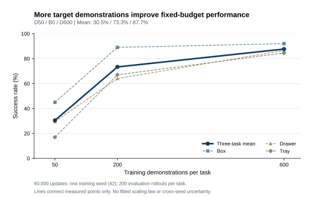
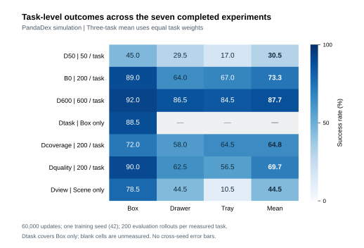

# 具身数据利用研究总方案：数据规模、类型与配比对 VLA / VLM 的影响

版本：v4 · 2026-10-24  
状态：研究设计，尚未启动本方案中的新训练。先开展以 π0.5 为起点的 VLA 研究，闭环评估仅用仿真；流程稳定后开展 VLM 研究及 VLM→VLA 迁移验证。训练可使用合格的真实机器人、UMI 和人类 EGO 数据，VLM 另做独立的视觉语言评估。  
目标：系统验证数据规模、数据类型、数据配比如何影响模型能力，形成可指导数据建设与模型训练的结论。预训练、中训练、后训练用于研究这些数据在什么时候使用更有效；历史实验记录保留。

## 1. 总问题、三条主轴与两条模型研究线

**我们要做的是数据利用实验：先验证不同数据规模、数据类型和数据配比对 VLA 的影响；当数据接入、训练和评估流程稳定后，再对 VLM 做同样的研究，并检验 VLM 的改善能否转化为 VLA 的行动能力。**

### 1.1 三条主轴

| 主轴 | 核心问题 | 基本对照 | 主要图表 |
| --- | --- | --- | --- |
| 数据规模 N | 数据增加到什么程度仍有收益？不同类型的边际价值和饱和点是否不同？ | 固定模型、来源类型和比例，改变独立数据量；区分固定算力和充分训练条件 | 每种配方的数据量—能力曲线，以及数据量×算力响应 |
| 数据类型 T | 夹爪、灵巧手、UMI、EGO 分别帮助哪些能力？视觉、语言和动作监督的作用有什么不同？ | 匹配可比数据量和计算预算，比较单类型、替换、留一类型及关键组合；内容覆盖作为单独因素 | 类型×任务/能力增益图、来源交互图 |
| 数据配比 w | 各类型怎么混合最好？比例是否随总量、任务和训练阶段变化？ | 固定类型集合、各来源可用数据池和计算预算，改变采样权重 | 配比—能力曲线、规模×配比热图与成本比较 |

来源类型与监督类型需要分开：同一段 EGO 可以提供视觉、语言或手部运动监督；改变监督形式时不能把效果全部算作更换了数据来源。配比实验保持可用数据池不变，实际独立样本覆盖和重复曝光是采样造成的结果，必须一起记录。

### 1.2 两条模型研究线及它们的联系

| 研究线 | 要验证的影响 | 主要判断标准 |
| --- | --- | --- |
| 第一条：VLA | N/T/w 对执行、泛化、迁移、少样本适配和保持已有能力的影响 | 仿真闭环成功率、任务完成度、目标示范效率、计算成本 |
| 第二条：VLM | N/T/w 对视觉、空间关系、动作/视频理解、任务推理及通用能力保持的影响 | 独立的视觉语言和具身理解评估，按能力分别报告 |
| 两者衔接：VLM→VLA | 通过数据训练得到的 VLM 改善，是否让相同动作训练流程得到更好的 VLA？ | 固定下游动作数据、动作模块与训练预算，再测闭环表现 |

P/M/F 是第二层控制变量：在预训练、中训练、后训练中分别研究 N/T/w，也研究同一数据放在不同阶段的差异。初期固定模型架构和参数规模；模型规模、架构更换与算法修改另设对照，不能与数据规模混为一谈。

最终结论应能回答“同样增加一批数据，应增加哪类内容，混合多少，在哪个阶段训练，对什么能力有效，以及是否值得相应计算成本”。可以得到随任务、机器人和预算变化的多个配方，不要求一个比例通用于全部情况。

已有三任务实验仅覆盖了**目标任务示范数量**等局部问题，见[已完成实验](../experiments/2026-10-pi05-dexterous-hand-data-ablation.md)。相同协议的旧扫描不必重做；但广域数据、不同来源以及 VLM 的规模效应仍需研究。历史 50/200/600 条结果不能代替这些新问题，也不把所有新训练固定为 60,000 步。

## 2. 三个训练阶段的操作定义

| 阶段 | 数据和训练职责 | 主要控制变量 | 判断价值的方式 |
| --- | --- | --- | --- |
| P：广域继续预训练 | 覆盖多任务、多场景、多机器人及合格的人类/UMI 信号，形成可复用起点 | 来源、任务/场景覆盖、监督类型、数据比例、计算预算 | 相同后训练协议下，新任务和新机器人的迁移表现；已有可执行接口上的直接表现 |
| M：中训练 | 在 P 与具体任务之间，面向目标机器人族、传感器、控制接口或技能族搭桥；保留适量广域数据 | 桥接数据选取、目标机器人但非目标任务数据、相关技能、广域回放比例、阶段长度 | 是否提高随后 F 的样本效率，能否被多个目标任务复用，是否损失通用能力 |
| F：后训练 | 面向明确目标任务或目标任务包，利用有限示范获得闭环性能 | 目标数据预算、外部数据回放、任务定向 UMI/EGO、优化策略 | 新场景成功率、少样本曲线、泛化、遗忘、成本 |

VLA 主线从同一现有 π0.5 权重 S0 出发。因此 P 严格说是**继续预训练**。不能把追加数据的结果写成从零训练基础模型的定律，也不能声称控制了 S0 原本看过的所有数据。

第 13 节的 VLM 线从一个固定的可训练 VLM 起点出发，比较数据训练带来的增量；它是正式的后续研究内容。若进一步研究“原始预训练多样性是否导致某能力涌现”，需另外控制更早的初始化和完整训练预算，不与现有 π0.5 的继续训练混报。已有基础权重的预训练数据若不透明，任务留出结论只对本项目新增训练数据成立。

M 的定义取决于实际数据分布与适配目的，不能把一次学习率重启叫作中训练。F 在本方案首先指监督后训练；仿真强化学习可作为后续独立研究，避免与第一轮数据利用问题混杂。

## 3. 文献如何减少实验量

以下为定向原文核对，检索截止 2026-10-24，不声称穷尽全部文献。“采用默认”表示本项目的设计选择；“局部复验”表示条件接近但仍有域差异；“保留研究”表示文献没有解决当前问题。论文出现正结果，不等于任何数据和机器人组合都应复现同样收益。

| 依据与原文位置 | 已有证据及适用范围 | 本项目的处理 |
| --- | --- | --- |
| [π0.5，2025，§V-C、Fig.10–11](https://www.physicalintelligence.company/download/pi05.pdf) | 作者的家庭操作评估中，去掉其他机器人来源损害表现；网络数据对未见物体/语言泛化的作用比单一整体任务分数更明显 | **跳过“异构数据是否可能有用”的存在性研究。** 为不同数据设置能反映其作用的评估；保留本地来源和比例对照，不能直接照搬原文配比 |
| [ReMix，CoRL 2024 / PMLR 2025](https://proceedings.mlr.press/v270/hejna25a.html) | 在 Bridge/Open X-Embodiment 设置中，学习域权重优于均匀或人工权重；方法需处理动作尺度与不同机器人损失不可直接比较的问题 | **不做庞大的穷举网格。** 先建立均衡/按规模采样基线，再以少量配比试验和一种自动权重方法竞争；其权重和收益数字不直接迁移到 π0.5 |
| [Emergence of Human to Robot Transfer，2025，§IV–V、Fig.2、7](https://www.pi.website/download/human_to_robot.pdf) | 在 π0.5 上，将带 3D 手轨迹和子任务标签的人类数据与相关机器人数据共同后训练；论文采用 50:50 混合，研究只在人类数据中出现的新场景、物体或语义，收益随机器人预训练多样性变化 | **先做论文启发的局部复验。** 将 50:50 作为候选起点，核对标签与相机条件；不先证明 EGO“一般可用”，也不把 50:50 视为最优。它没有解决 EGO 在 P/M 的最佳用途 |
| [同上，§V-E/F、Fig.11–12](https://www.pi.website/download/human_to_robot.pdf) | 人类数据收益涉及高层与低层训练；腕部相机收益依任务而异 | **不预设 EGO 只提供语义，也不因缺腕相机就直接判无效。** 先用可得到的可靠标签；观察到收益后，再用少量组件消融确定机制 |
| [UMI，RSS 2024，§III-B、V](https://arxiv.org/html/2402.10329v2) | 手持夹爪系统使用相对轨迹和延迟匹配；相对轨迹是在一个动作块中相对同一参考末端位姿，区别于逐步 delta | **采用接口原则，跳过全套坐标系穷举。** 验收时间同步、参考系、双臂关系和回放；如需改现有模型表示，只做一个有动机的对照。夹爪开合不等于多指关节标签 |
| [Rethinking VLA Scaling，2026，§V-A/B、Table I–IV](https://arxiv.org/html/2602.09722v1) | 在作者的 VLA、LIBERO/RoboCasa 和真机设置中，动作表示影响迁移；逐步增加异构来源不保证收益 | **保留数据对齐和来源消融，跳过“越多来源必然越好”的预设。** 与 π0.5 的正向结果共同说明，收益依赖模型、数据与任务条件 |
| [同上，§IV-B、V-C、Table V](https://arxiv.org/html/2602.09722v1) | 感官 dropout 和“先冻结 VLM 训练动作模块，再全模型训练”的流程未稳定获益；模型以 InternVL 为骨干 | **不把额外 warm-up、强 dropout 列为首批默认。** 注意这不是 P→M→F 的数据阶段实验，不能据此取消 M，也不能推断 π0.5 上所有冻结策略都无用 |
| [Is Diversity All You Need，核对 v2，§III–V](https://arxiv.org/html/2507.06219v2) | GO-1/RDT 的受控子集比较支持区分任务与场景覆盖；高质量单机器人来源也能跨机器人迁移；示范速度差异可能干扰学习 | **将内容多样性、机器人数量和动作一致性分开。** 先做等量“广覆盖/目标相关”小对照；暂不扫描大量机器人数量或引入速度重整算法，除非本地诊断支持 |
| [VLM4VLA，ICLR 2026](https://arxiv.org/abs/2601.03309) | 在作者的统一适配与多个机器人基准中，VLM 通用能力及部分具身辅助任务的提升，不稳定地对应更好的下游控制 | **VLM 评估和 VLA 闭环评估分别保留。** 不先做大量“换更强 VLM”的模型排行榜；优先比较同一 VLM 经不同数据训练后的迁移效果 |
| [Prismatic VLMs，ICML 2024，§4.4](https://arxiv.org/html/2402.07865v2) | 作者发现训练时间与新增视觉语言数据均会影响结果，数据来源的作用也有差异 | **VLM 的数据量和训练量分开控制。** 不把其具体 epoch 数当通用默认；为本项目测量学习曲线 |
| [RT-2，CoRL 2023](https://robotics-transformer2.github.io/) | 在作者的 VLM 到机器人控制流程中，机器人与视觉语言数据共同微调支持知识迁移 | **保留顺序训练与联合训练对照。** 作为研究动机，不将其动作表示或配比直接迁移到 π0.5 |

这里没有充分证据可以跳过的核心问题是：**我们的不同数据类型如何随规模增长产生收益，最优配比怎样随总量、任务和训练阶段变化，以及哪些 VLM 数据收益能转化为 VLA 闭环收益。** P/M/F 分工和来源互补用于解释这些关系。

### 最小复验包与升级规则

- **EGO 后训练复验：**相关机器人任务单训 vs 同一实现的机器人+EGO；优先使用论文启发的 50:50 候选，评估只有 EGO 提供的新概念。它是配方迁移检查，不声称严格复现论文。没有可靠手轨迹或子任务标签时标注为简化方法，不冒充原配方。
- **多样性复验：**同一来源、等量合格窗口、同算力，比较广任务/场景覆盖与目标技能相关子集。保留目标任务外推和场景外推两个分数，避免把两种多样性混成一个。
- **自动配权复验：**固定数据和表示后，比较最好的简单静态配方与一种 ReMix 启发的方法；计入学习权重的额外计算。没有可比较损失尺度时先不启动。
- **不必重复的项目：**本项目已有的同协议目标示范数量扫描、明显不合法的动作拼接、无动机的所有坐标系/冻结/dropout 组合。
- 初步验证可用一个种子判断接口和方向；若用它决定跳过后续研究，至少补一个独立种子或独立任务族。与文献方向一致且没有实质退化时采用默认；相反、效果依任务而变或区间太宽时，升级为正式实验。未复现不等于推翻原论文。

## 4. 数据池：来源、内容与监督分别登记

| 互斥的一级来源 | 含义 | 可用监督；需要单独登记的子类 |
| --- | --- | --- |
| G：机器人夹爪数据 | 机器人实际执行的夹爪示范 | 臂/末端轨迹与夹爪状态；真实/仿真、单/双臂分层 |
| D：机器人灵巧手数据 | 机器人实际执行的多指示范 | 臂运动、手关节或有效控制命令；手型、控制模式分层 |
| U：手持接口数据 | 经典 UMI、具备多指标签的手持接口等 | 经典 UMI 与 DexUMI 按实际标签分开；不能因为名字相近合并动作语义 |
| H：人类 EGO 数据 | 人类第一人称采集 | 可靠手轨迹、子任务/语言、视觉监督按可用性区分；原始视频、人类动作、重定向伪动作分开 |

U 的夹爪/多指属性作为二级标签，不再重复计入 G/D。H 经机器人实际执行且验收成功的回放可进入 G/D，但保留共同采集祖先；同一来源的原始、转换、重定向、回放版本不能泄漏到不同训练/测试边界。是否联合使用多个派生版本作为单独方法因素记录。

每条数据同时标注：技能族、物体/场景、机器人、控制参考系与频率、视角、监督有效性、成功/失败状态、采集者/会话、原始轨迹祖先。长轨迹相邻窗口不作为独立示范计数。

训练数据按三种职责组织：

- **广域池：**服务于 P，按任务/场景/机器人覆盖组织。
- **桥接池：**服务于 M，含目标机器人非目标任务、其他机器人相关技能、可对齐的 UMI/EGO，以及广域回放。
- **目标池 T：**服务于 F，按任务包固定 K 条独立目标示范。T 是按实验角色从 G/D 中抽出的集合，不是另一个重复计数的来源。

数据比例以进入训练的合格时间窗采样概率定义，同时报告独立 episode 数、重复曝光、图像/token 数、有效动作通道、各损失样本数和 GPU 小时。采样比例与损失权重分别记录、分别实验。

动作语义不统一时采用明确的来源适配、有效维度掩码或输出分支；不将夹爪宽度填入多指关节，不将人手轨迹当作机器人执行真值。缺相机显式标记；来源归一化只用训练数据统计。新增结构或辅助目标后，用新实现重跑对应的无外部数据基线，避免将实现收益当作数据收益。

## 5. 评估随研究问题设计，比较内固定

不固定一个永远不变的三任务测试集。先建立任务/机器人/场景目录，再为不同问题创建有版本的面板；每一项对照内部使用相同任务、示范预算和配对评估场景。不能在看过模型结果后改任务权重或删除失败任务。

### 5.1 五种不同的数据留出关系

| 面板 | P/M 中可以出现什么 | F 中可以出现什么 | 结论边界 |
| --- | --- | --- | --- |
| A：已知任务的新实例 | 允许同任务，隔离采集祖先及评估场景 | 训练实例的目标示范 | 常规任务表现、场景/物体泛化与遗忘 |
| B：全新任务/技能族 | 对严格版本，从所有新增机器人、UMI、EGO 数据中排除该目标任务族；任务名同义词和派生任务一并检查 | K 条新任务示范；另设零示范子项 | 上游是否提高学习新任务的能力；只换初态不算新任务 |
| C：跨机器人技能迁移 | 目标技能可在其他机器人出现，但目标机器人上的该技能缺席；M 可含目标机器人的其他技能 | 该机器人上 K 条目标技能示范 | 相同技能跨机器人迁移，与 B 分开解释 |
| D：新机器人适配 | P 排除该机器人；M 可使用其非目标任务，用来学习接口 | K 条该机器人目标任务示范 | P 对新机器人适配的帮助、M 的桥接价值 |
| E：EGO/UMI 独有信息 | 机器人数据缺少特定目标概念、场景关系或组合；所指定的 U/H 可以包含它 | 主实验不提供该概念的机器人示范，仅允许基础技能示范；另设少量目标示范的正对照 | 指定来源是否真正提供机器人数据缺少的信息 |

这些角色不能混用：E 中允许人类演示目标概念是研究设计；B 的“所有新增来源均未见任务族”不允许这样做。每个结果绑定自己的数据留出清单。共享 P/M 仅限留出规则兼容的目标；严格 B 与包含该任务概念的 E 必须使用不同训练清单和父模型。研究任务族留出时，可先统一留出一组目标任务族，让多个目标复用上游模型，再以另一组留出划分确认。F 的 K 示范与评估轨迹、初态、采集会话独立；同任务跨机器人时明确是否共享物体、仿真资产与生成模板。

对新机器人只有在动作接口已定义并可执行时才报告零示范控制；需要校准、适配器或 M 数据时如实记录，不把它称作完全零样本。所有“未见”声明还受 S0 历史数据未知的限制。

### 5.2 基准组合与规模

能力轴至少包括抓取放置/分类、关节物体操作、双臂协同、精确接触/装配，以及条件允许时的工具操作或长时序组合。技能族依据操作与接触结构定义，不能靠改任务名称增加数量。

| 候选资源 | 用途 | 当前可承诺的边界 |
| --- | --- | --- |
| [DexMimicGen](https://dexmimicgen.github.io/) | 官方展示九任务，可从既有三任务扩展到其他技能；适合保持历史可比性 | 既有三任务以已完成闭环为证据；其他任务仍逐一验收环境和控制接口 |
| [Bench2Dex](https://bench2dex.github.io/) | 官方描述 26 任务、12 种手型，可支持跨手型和扰动研究 | 论文/文件清单不证明本地环境可运行；抽样数据中无 RGB、疑似副本或静止采集的部分不能直接当合格操作示范 |
| 夹爪仿真任务组 | 验证夹爪数据的直接能力和向灵巧手的迁移，避免所有来源都只在灵巧手上打分 | 优先复用可运行环境；若现有任务覆盖不足，再验收一个额外基准，确定版本后登记 |

开发期先落地 **6 个任务×机器人单元，覆盖至少 3 个技能族、2 种机器人配置**；优先包含夹爪与多指两个接口。确认期目标扩展到 **12–20 个单元、4–6 个技能族、至少 3 种机器人配置**，条件允许时含两个不同多指手型。数字是覆盖目标，需通过可执行性和有效示范验收后锁定。

“任务×机器人单元”不是独立技能数；同一任务换三个手型不能报告成三个独立任务族。最终确认应包括未用于选择配方的任务族或机器人，以及新冻结场景。若某覆盖轴无法落地，收窄该轴结论，不用增加旧任务 rollout 数量冒充覆盖。

### 5.3 每阶段留下的成绩

- P 后：已有接口上的直接能力，以及用统一 F 协议得到的迁移成绩。
- M 后：目标机器人非目标任务能力、保留的广域能力，以及统一 F 的表现。
- F 后：目标任务、未见实例/物体、适用的语义或组合变化、对其他任务的遗忘。
- K 默认候选为 10/50/200 条独立示范，采用嵌套子集；零示范与高数据参考按任务条件另列。先在 K=50 比较方向，再为关键分支补曲线。

这不是重复已有的目标数据量实验：本次比较的是**不同上游数据配方是否改变同一新任务的学习曲线**。

## 6. 研究问题与最少必要对照

| 问题 | 关键对照 | 希望形成的决策 |
| --- | --- | --- |
| 不同数据配方如何随规模增长？ | 固定配方和预算的嵌套规模曲线；关键点补较长训练与子集重复 | 确定边际收益、欠训练与饱和范围 |
| 最佳配比是否依赖总量？ | 两个规模档复查同一组配比，保持其他条件一致 | 确定配方能否随数据扩展，避免外推单点最优 |
| P 应追求广覆盖还是相关性？ | 同来源、等窗口的广任务/场景覆盖 vs 目标技能相关子集；共享 F | 建通用模型时如何选数据；何时应转向目标相关数据 |
| G 与 D 如何分工？ | 固定总机器人曝光，改变 G:D；在夹爪、多指和新手型上分别评估 | 夹爪数据是否提供可迁移能力，多指细节是否需要 D 补足 |
| U/H 在哪个阶段最好用？ | 分别置于 P、M、F，以及必要的跨阶段组合；匹配累计曝光 | 区分通用知识、接口桥接和任务定向迁移 |
| M 是否必要？ | S0→F、P→F、M→F、P→M→F；增加同算力替代基线 | 是否值得建立可复用的机器人/技能族中间模型 |
| 数据互补还是相互干扰？ | U 与 H 的 2×2 来源组合；P 广覆盖程度×F 是否加入 H | 找到单来源筛选会漏掉的组合或阶段依赖 |
| F 怎样用外部数据？ | 目标单训 vs 保留上游数据 vs 任务相关 U/H；不同 K | 何时应集中拟合目标、何时混合能减少过拟合或遗忘 |
| 预算投在哪一阶段？ | 相同总计算下改变 P/M/F 分配，报告多任务复用成本 | 同样算力是扩大上游能力还是延长目标训练更值得 |
| 数据问题还是训练方法问题？ | 固定数据配方，只变一个表示/损失/参数更新因素 | 指导必要的算法调整，避免用算法差异冒充数据收益 |

“夹爪管语义、灵巧手管精细控制、UMI 管桥接、EGO 管概念”只能作为初始假设。必须允许数据在多个阶段、多个能力轴上起作用，结果也可能表明某个来源在当前条件下没有增益。

## 7. 第一轮如何开始：共享上游，分叉评估

### 7.1 先完成可执行研究平台和文献复验

1. 验收任务环境、示范和动作接口；建立来源/任务/场景留出表。
2. 在新实现上跑目标单训，确认已有能力和新任务训练可用。历史三任务只作回归。
3. 先完成第 3 节中与现有标签相符的 EGO 后训练局部复验，以及必要的动作表示对照。
4. 冻结开发任务包、统一 F 训练规则、评估场景和计算计量，再开始共享 P。

新接口短跑仅检验数值、模态、动作及闭环正确性。性能筛选预算需另外校准，不能因为短跑尚未学会就淘汰数据来源。

### 7.2 P 的首批信息量较大的四组

先用参考 P-R 完成第 9.0 节的规模与预算校准，选定共同的数据量和计算档，再比较本节来源组合。令 R 为合格 G+D 的固定参考机器人混合，内部任务、来源平衡方式不变。以下比例是**诊断用起点**，不是文献给出的最优值。

| 上游模型 | R | U | H | 作用 |
| --- | ---: | ---: | ---: | --- |
| P-R | 100% | 0 | 0 | 机器人数据参考 |
| P-RU | 80% | 20% | 0 | 用 U 替换部分机器人曝光 |
| P-RH | 80% | 0 | 20% | 用 H 替换部分机器人曝光 |
| P-RUH | 60% | 20% | 20% | 检验 U/H 联合使用是否不同于分别添加 |

四组使用相同 S0、实现与 P 计算预算。没有合格 U/H 的单元先标为不可执行，不用空数据或不等价来源填补。数据读取成本和辅助目标计算不同，应按实测 GPU 小时匹配并记录实际曝光；不能仅以更新步数声称等算力。

这组 2×2 检验的是**固定预算下来源替换的交互**。其差分可能同时受到 R 减少的影响；若出现明显组合收益，补固定 U+H 总份额的 U-only、H-only、U+H，以及必要的 R 曝光匹配对照，再解释互补机制。即使两个单来源组均无明显收益，也保留组合组，不提前剪掉可能的交互。

G:D 不默认最佳。第一轮可用按来源/任务平衡后的中间比例作参考；接口通过后补 G 偏重、D 偏重两个端点（如 80:20、20:80），复用相同 F 评估。若当前覆盖无法匹配任务分布，只将差异归为来源整体效果，不单独归因于夹爪或手型。

### 7.3 从共享模型分叉，而非每个目标重训 P

每个 P 都在相同目标任务包上按同一 F 协议训练和评估。第一轮用 K=50，保留 S0→F 作为没有追加 P 的基线。

以一个共同留出协议内的 6 个开发任务×机器人单元、逐单元后训练为例（不同留出协议所需父模型另计）：

- 4 个共享 P。
- 4×6=24 个 P→F 分支，加 6 个 S0→F，共 30 个 F。
- 后续加入 M 时，若每个 P 为 2 种目标机器人各建立一个可复用 M，则新增 8 个 M；S0→M 基线另需 2 个 M。它们再接相同的 6 个任务单元，共新增 30 个 F。

这是完整对照的规模示例，不是全部立即执行的承诺。先验收代表性单元与计算成本；昂贵阶段分批推进，保留必要基线与来源交互。若改成联合多任务 F，必须将任务包作为实验单元，统一改所有对照和运行数量，不能与单任务 F 混报。

P 的父模型只训练一次并被多个目标复用，但最终确认要重复上游种子：共享一个 P 下的多个 F 分支不是多个独立的 P 训练重复。

## 8. M 与 F：对训练阶段本身做实验

### 8.1 中训练的职责先拆开

在同一个 P 下比较三种 M 候选，目标任务按第 5 节角色排除：

- **M-robot：**目标机器人上的其他任务，主要检验接口/视角/控制适配。
- **M-skill：**其他机器人或 U/H 的相关技能，主要检验内容桥接。
- **M-both：**两者结合，并保留广域回放。

先选少数目标机器人和任务族，固定 M 预算，比较不经过 M 的分支。若某 M 只改善一个具体目标而无法复用，就按任务定向训练评估其成本，不包装成通用中间模型。

### 8.2 路径比较必须分成两个问题

**上游模型的价值：**S0→F、P→F、M→F、P→M→F 使用相同 F 示范、优化规则与预算，报告终点表现和上游成本。这回答相同适配条件下哪个起点更好；不同路径总成本不一定相同。

**整条路径是否划算：**将所有路径限制到相同总 GPU 预算；为跳过 P/M 的基线把剩余预算用于延长 F 或另一种预先规定的训练。不得用更多总训练量取得的优势证明阶段设计更好。

对有希望的 P→M→F，再比较：

- 相同数据累计曝光的 joint(P+M)→F；
- 相同数据累计曝光的 M→P→F；
- 保留 F 的情况下，将指定 U/H 监督移到 P、M 或 F。

顺序实验固定累计来源/任务窗口、模型初始化、总计算及优化日程，优先只改变数据出现的时间。如果阶段专属学习率或参数冻结也一起变化，应称为整套配方比较，再单独拆解，不将收益全部归于数据顺序。

### 8.3 来源×阶段交互，不只筛选“最佳来源”

至少为 U 与 H 各保留一次 P/M/F 位置对照。使用共同的 P→M→F 框架，在各阶段安排同样数量的该来源窗口，并调整机器人背景窗口，使全程累计曝光可比；若算力或监督目标使严格匹配不可行，明确以哪一种资源为主控制，并补记偏差。

另保留一个由文献直接推动的交互：**P 的广任务/场景覆盖程度 × F 是否加入任务定向 H**。若广域 P 的零示范成绩差别不大，但它使后续 H 更有效，这仍是有价值的上游能力，不能只看 P 的直接成功率。

### 8.4 后训练数据配方

在同一上游模型上，比较目标单训、目标+广域回放、目标+相关 U/H。先在 K=50 找方向，再用嵌套 K=10/50/200 验证。H 的 50:50 文献候选和小比例回放是不同假设，分别登记。

新增人类辅助目标时，补“相同辅助目标、仅机器人视频”的控制；人类手轨迹、子任务标签和重定向伪动作的消融放在出现可重复收益后。不同监督可用性导致的版本差异应如实标注。

## 9. 数据配比与算力怎么搜索

### 9.0 数据规模是独立实验轴

在相同模型、阶段和数据配方下，以合格池的 10%/25%/50%/100% 作为首轮规模候选，形成嵌套子集；实际绝对数量在验收后登记。按来源、机器人、任务和场景分层抽样，尽量保持组成比例，明确小规模下不能维持的覆盖条件。

规模主轴按去重后的独立轨迹/采集组计数，同时报告有效窗口、时长、图像和 token 数。相邻帧、同轨迹多种转换和反复生成问答不算新增独立经历。不同模态的样本单位不强行等价。

先做一个参考配方的规模曲线，再为关键单类型/混合配方补曲线；从中选两个规模档检验最优配比是否变化。不能只在一个总量下找到配比，就推断它在更大数据量上仍最优。

固定算力比较回答“相同训练成本能否用好更多独立数据”；对关键规模点补较长训练，判断大数据是否受欠训练限制。增加数据同时增加更新数时，必须加相同计算预算对照。每个规模确认点重复数据子集抽样与训练随机性，区分选到哪些轨迹和模型优化的影响。

### 9.1 每个阶段分别定义配比

P 的权重可写为 G/D/U/H；M 的权重为机器人桥接/技能桥接/广域回放；F 的权重为目标/回放/任务相关 U/H。不要把三个阶段压成一个“外部数据占比”。

每一层都分开记录：来源间采样、来源内任务/机器人平衡、单条轨迹采样、损失权重。初期固定后三者或明确其规则，先搜索来源配比；有明确诊断后再改变内层规则。

### 9.2 搜索顺序

1. **建立简单基线：**先测参考配方的规模响应，再按有效数据规模采样，以及按来源/任务平衡采样。避免小数据源被高频重复后仍被称为数据更丰富。
2. **粗搜索：**机器人 G:D 两端点与中间点；U/H 从 0、小比例、较高比例中选点，例如 0/10/30%，H-F 额外保留文献启发的 50%。选择点覆盖假设，不全排列。
3. **局部细化：**围绕候选最优区间补 1–2 个点；在相同预算下比较固定外部份额的单来源与组合。
4. **自动权重：**加入一种 ReMix 启发的配权方法，与最强静态配方比较。不能直接按不同动作空间的原始 loss 大小调权，也不能使用最终测试反馈更新权重。
5. **动态课程：**在累计曝光匹配下比较固定权重、前期广域后期集中、阶段间平滑变化。只有静态方案与阶段职责有证据后才扩大搜索。
6. **联合复查：**先按阶段优化节省计算，再对最终 P/M/F 组合做小规模交互复查；坐标式搜索可能漏掉阶段之间的配合，不能直接声称全局最优。

任务相关性、场景多样性、质量和机器人结构相似度，优先在同来源内作等量对照。数据条件允许时构造“相关/不相关技能 × 相近/不同机器人”的交叉设计；缺少可匹配单元时只报告来源整体效果。

### 9.3 两种预算视角

- **固定算力：**比较不同数据替换是否更有效，是主要实用决策口径。
- **固定目标曝光：**仅对关键候选补齐目标示范曝光，判断收益/退化是否只是目标数据被稀释。再配相同总算力的目标单训，分离额外训练的效果。

先测吞吐，再定义 P/M/F 的预算单位；不从历史 60k 步直接推出新方案长度。代理筛选至少在两个预算档检查排序，不能依据一次极短训练的排名淘汰慢收敛来源。训练 loss 仅用于诊断，核心筛选依赖闭环开发评估。

对一个目标任务报告完整端到端成本；对 N 个下游任务再报告共享 P/M 后的摊销成本，同时保留原始总成本。数据清洗、伪标签生成、权重学习和失败重跑的成本单列。

## 10. 结果曲线与图表是研究的一部分

曲线的横轴、分组、评估点和不确定性定义在训练前登记。只有真实观测才能成为结果点；示意关系如有需要，必须显著标为研究假设，不与结果混排。不同实验条件不能用一条平滑线串起来。

| 图表 | 横轴 / 纵轴 | 分组与主要结论 |
| --- | --- | --- |
| C0 独立数据规模响应 | 去重后的数据量 / 能力分数或闭环成功率 | 每条线代表一种固定类型/配方；按阶段、算力档分开，记录子集抽样与种子不确定性 |
| C1 数据配比响应 | 某阶段来源占比 / 闭环成功率或相对基线增益 | 按阶段、任务族和机器人分面；看最优区间、负迁移及配比是否可迁移 |
| C2 目标示范效率 | K（可用对数坐标）/ 成功率 | 每条线是一个上游配方；看相同性能是否需要更少示范，不用纯数据量曲线代替迁移对照 |
| C3 算力效率 | 累计 GPU 小时 / 成功率 | 对照 P/M/F 路径，标训练阶段边界；同时给总成本与多任务摊销视角 |
| C4 阶段能力轨迹 | S0、P 后、M 后、F 后 / 各能力面板分数 | 已有接口直接能力与“统一 F 后”的迁移分数分图；看能力获得与遗忘 |
| C5 来源×目标迁移图 | 来源或上游配方 × 任务族/机器人 / 增益热图 | 看收益覆盖面，避免均值掩盖某种手型退化；标出未测单元 |
| C6 来源/阶段交互 | 基础条件 / 加入来源后的增益 | U×H、P 覆盖×F-H、M×F 配方；展示差分及区间，不只展示各自终点 |
| C7 泛化与保持能力 | 扰动强度或类型 / 成功率；目标增益 / 旧能力下降 | 分开几何、视觉、物体、语义变化；展示收益与遗忘的权衡 |
| C8 训练诊断 | 更新或曝光 / 分来源训练与验证损失、实际采样比例 | 解释收敛、数据稀释和异常；不同动作空间的原始 loss 不直接横向排名 |

数据量不足以支持连续曲线时用散点和连接实测点的细线；不拟合三点“scaling law”。方法类别没有自然顺序时用点图、条形图或热图。每图说明任务、机器人、训练预算、种子数、评估数、误差条定义和来源表。

最终多种子曲线显示单种子点及汇总区间。只有一个训练种子的结果明确标记；不能伪造跨种子方差，也不能把多个任务的差异当训练随机性误差条。训练日志尚未提取时，不凭终点成功率倒推出训练曲线。

### 已有真实结果的起点

以下图来自已完成、同种子和同 60,000 步协议的七组实验，详见[原记录与完整数值](../experiments/2026-10-pi05-dexterous-hand-data-ablation.md)。它们是历史对照，不是本方案新实验结果。

图 1：D50/B0/D600，目标示范数为每任务 50/200/600；各任务 200 次评估。实线突出三任务等权均值，其余线展示各任务。连接线仅帮助阅读实测点，无拟合或外推；单训练种子 42。

图 2：七组实验的每任务成功率及三任务均值；Dtask 仅训练和评估 Box，因此其他单元为空且无三任务均值。均值按原始任务成功数计算；表格中的一位小数仅用于展示。单训练种子 42，无跨种子误差条。

## 11. 怎么判断结果足以改变决策

主结论分三种报告：平均迁移效果、最弱任务族/机器人表现、成本与样本效率。先按任务族内任务等权，再按任务族等权汇总，并单列机器人；不让某个拥有大量相似任务的基准主导总分。历史三任务只是其中一张保持能力面板。

- **开发筛选：**少量种子与较小场景包用于缩小方向，不宣布稳定最优。
- **最终确认：**基线及 1–2 个候选至少 3 个独立训练种子；上游和下游种子分层记录。涉及 P 的主张应重复 P，不只重复其 F。
- **配对评估：**同任务、同初始场景、同推理随机数规则比较模型，记录双方都成功、仅一方成功、都失败。按任务/种子/场景层次估计区间，不能把所有 rollout 当独立训练重复。
- **实际重要性：**在看结果前按任务确定最小值得投入的提升和可容忍退化；可用 5 个百分点净增益、3 个百分点平均保持能力下降作初始讨论值，正式阈值与场景数结合先导方差再冻结。这些数字不是通用统计门槛。
- **场景数量：**最终每任务×种子可从 200 次配对评估起步，依据预设最小效应和先导数据做功效/精度估计；200 次不自动保证能区分小幅提升。
- **错误处理：**策略超时、无效动作和执行失败按任务规则计失败；环境基础设施异常单列并对所有模型按相同规则重跑，不能选择性删除。
- **选择与确认隔离：**候选选择只使用开发任务/场景。最后使用未参与调参的任务族、机器人或场景确认；看过结果后再修改配方，需新的确认面板。

结论可以是有条件的：例如“广域 P + 相关技能 M 对新手型的低 K 任务更有价值，但高 K 时直接 F 更省计算”。这种规则比某个三任务均值最高的单一配比更符合研究目标。

## 12. 分批执行与记录

| 批次 | 重点 | 继续投入前必须拿到的证据 |
| --- | --- | --- |
| 0：平台与文献复验 | 数据角色、可执行任务、同实现基线、EGO-F 最小复验 | 能闭环评估；数据和标签支持所声称的问题 |
| 1：规模与数据类型 | 参考配方的规模曲线、共享 P 来源组合、G:D 端点、广覆盖/相关子集 | 跨多个任务族的迁移结果；无接口混杂；代理预算排序已检查 |
| 2：中训练与阶段放置 | M-robot/M-skill/M-both、路径与来源位置 | 相同 F 条件的增益，以及同总计算下仍值得的路径 |
| 3：配比与方法 | 各阶段粗到细配比、自动权重、必要的方法改动 | 静态基线足够强；改变因素可解释；计算开销完整 |
| 4：独立确认 | 多种子、独立任务/机器人、K 曲线、泛化和遗忘 | 得到适用范围明确的规则和成本比较 |
| 5：下一轮数据建设 | 对照新增同等成本的数据内容 | 决定应增加哪类任务、场景、机器人或人类监督 |

批次 0–5 描述 VLA 线。VLM 在第 13 节规定的稳定条件满足后启动，不必等所有 VLA 网格探索完毕。批次按信息收益排优先级，不要求所有支线完成后才能推进。第 3 节文献支持且本地复验一致的支线可缩减；出现交互或相反结果的支线优先展开。尚未验收的基准不提前计入可执行实验数量。

每项实验训练前登记：研究问题、文献先验、阶段路径、唯一变量、数据角色与留出关系、来源和任务权重、监督方式、初始化、预算、种子、模型选择规则、评估面板、计划图表，以及什么结果会改变下一步决策。

每项实验结束后更新：实际数据曝光、闭环结果、区间、失败类型、算力与数据处理成本、曲线、可支持的结论、仍未分离的因素。模型/训练方法调整只写行为层面的说明及对照，不上传具体代码。

公开仓库保存整理后的研究方案、实验记录、汇总数值和图表；不提交训练代码、原始配置、原始日志、数据样本、权重或内部资源信息。新图与对应数值表一起更新；已有图不会被当作未开展实验的证据。

## 13. VLA 流程稳定后，开展 VLM 实验

### 13.1 什么时候开始

“稳定”指数据身份与留出关系可靠、基线可重复、训练和评估完整运行、至少两种数据类型已通过接入验收，并取得首轮可解释的规模/类型/配比对照。它不要求已经找到 VLA 全局最优配方，也不要求所有数据来源都显示正收益。

现在即可共用原始来源标识、采集组划分和任务/场景目录；VLM 的问答、定位、时序标签和独立评估需专门设计。两条线共用来源管理，各自维护训练目标和测试答案。

### 13.2 VLM 使用什么数据，研究什么能力

| 内容或监督类型 | 候选信号 | 要测的能力 |
| --- | --- | --- |
| 通用视觉语言 | 合格图文、问答、指代表达 | 通用理解与原有能力保持 |
| 机器人操作理解 | 机器人图像/视频的动作、状态、关系、子任务标签 | 当前在做什么、物体状态、是否完成、下一子任务 |
| EGO / UMI 理解 | 人类或手持接口视频及对应的可靠标注 | 第一人称理解、人—物交互、技能识别、时序与步骤关系 |
| 空间与接触关系 | 定位点/框、相对关系、可见接触和可验证状态 | 目标定位、空间约束、动作相关的视觉判断 |

VLM 的原始来源仍可用 G/D/U/H 追踪，但采样还要按监督任务分类；一段视频派生出的多个问答共享同一原始采集组。先划分采集组，再生成标签，避免训练和测试共享视频内容。自动标注需抽查，不能将未经验证的描述视为真值。

未来帧可用于生成当前时刻的标签，但只有任务定义允许时才可成为模型输入。若研究“下一步”，必须明确可见历史，不能把答案对应的未来片段输入模型。机器人成功与失败片段可用于状态/完成判断，但评估标签与训练标注必须独立。

### 13.3 VLM 也沿 N/T/w 三条主轴推进

首轮固定一个 VLM 起点、参数规模、分辨率、视频采样规则和优化方法；选型时核实与后续动作模型的兼容性。

1. **规模：**固定监督配方，做嵌套数据量与训练计算的对照，记录独立视频/图像来源、问答数量和 token 曝光。
2. **类型：**固定预算，比较通用数据、机器人理解、EGO/UMI 理解、空间定位等监督的边际作用；保留相同视频内容、不同标签形式的对照以区分内容与监督。
3. **配比：**先优化通用数据与具身数据的比例，再细分具身监督；在至少两个数据规模档复查比例，测量通用能力损失。
4. **阶段：**配方稳定后比较继续预训练、具身领域中训练、任务定向后训练，以及等曝光的联合/顺序方案。

评估至少覆盖对象/指令定位、空间关系、动作与时序理解、任务进度/完成判断，并保留通用视觉语言面板。优先采用有客观答案的指标；开放回答如使用模型评分，需要固定评分规则并人工抽查，不能只用同一个生成模型自评。具体公开基准和本地任务在兼容性与数据污染检查后锁定。

### 13.4 将 VLM 改善接回 VLA，验证真实行动收益

独立 VLM 分数改善是第一层结果；相同下游动作训练条件下的闭环改善是第二层结果。二者分别报告。VLM4VLA 的实证结果提示，这种迁移不能默认成立，见第 3 节。

| 分支 | 上游视觉语言训练 | 下游动作训练 | 回答的问题 |
| --- | --- | --- | --- |
| L0 | 固定原始 VLM 起点 | 固定动作模块初始化、机器人数据、优化规则和预算 | 基线 |
| L1 | 同起点增加等算力通用视觉语言训练 | 与 L0 一致 | 额外训练计算本身的作用 |
| L2 | 同起点使用候选具身 VLM 数据配方 | 与 L0 一致 | 具身数据训练是否改善行动能力 |
| L3 | 视觉语言与动作联合训练 | 与 L2 的完整流程匹配累计数据曝光和总计算 | 同样数据联合训练还是先 VLM 后 VLA 更有效 |

只选少数有代表性的 VLM 配方接入闭环评估，保留能力改善但动作未改善的情况。之后可在关键对照上比较视觉模块冻结/更新，以定位瓶颈；这属于方法实验，不能混入首轮数据主效应。

这里要求兼容的 VLM→动作模型接口。不能随意把另一个 VLM 权重替换进已训练的 π0.5，再把性能变化全部归为数据。如果现有 π0.5 无法提供受控的组件初始化，就建立独立且各组一致的适配轨道；其结果与 S0 继续训练主线分别标注。先用原始 VLM 在同一轨道建立有效基线，再解释其他分支。

### 13.5 两条线共同回答的最终问题

同一批具身经历在三种用法下分别有多大价值：**直接用于 VLA 动作学习、用于 VLM 理解学习后迁移、以及视觉语言与动作共同训练。** 对有共同支持的数据子集，匹配原始来源、数据量与总计算，比较能力和成本；不同标签及处理成本单列。

新增 VLM 数据规模/类型/配比曲线，以及“VLM 能力变化—VLA 闭环变化”配对图。后者只能展示关联；是否有因果迁移，依靠上述固定初始化和下游训练的受控对照判断。最终据此决定哪类数据应保留动作标签，哪类应增加理解标注，哪些监督需要结合使用。
